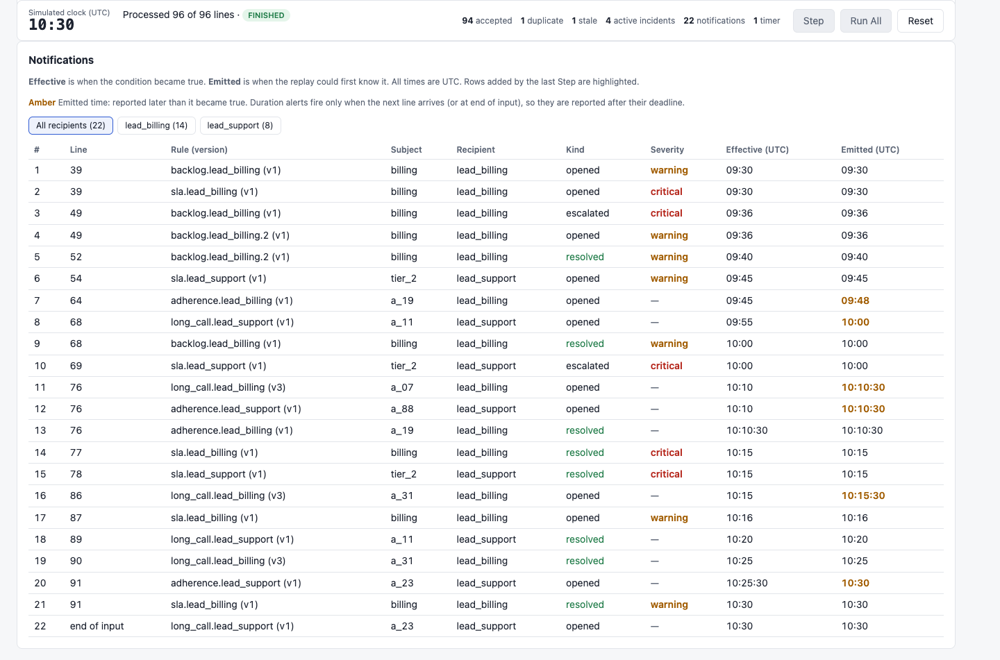

# Intraday Alerts

*Intraday alerts for contact-center team leads — a take-home for Assembled by Shravya Munugala.*

Team leads configure alert rules (backlog, SLA risk, adherence, long calls), replay a morning of operational events (09:00–10:30), and see who would be notified, when, and why. Rules can be edited and created in the browser; every change is versioned, persisted in SQLite and recovered after a restart.

I focused on team leads because they directly manage queues and agents and can act on operational problems during a shift. Supporting one clearly defined audience also kept the notification experience focused.

> **This is a deterministic replay of historical events, not a live streaming service.** It reads `data/events.jsonl` one line at a time in file order, with a simulated clock. The same inputs and rule changes always give the same notifications. See [Replay vs. live](#replay-vs-live) for what that changes.



## Quick start

The repository is public, so it can be cloned directly (a ZIP of the repository works the same way).

**With [uv](https://docs.astral.sh/uv/)** (installs Python 3.12 from `.python-version` if needed, and the exact versions in `uv.lock`):

```bash
git clone https://github.com/Shravya29M/assembled-alerts.git
cd assembled-alerts
uv sync --extra dev
uv run uvicorn alerts.api:app        # then open http://127.0.0.1:8000/
uv run pytest                        # in another terminal
```

**With pip** (Python 3.12+). The install must be editable (`-e`), because the app reads `data/events.jsonl` from the repository:

```bash
python3.12 -m venv .venv
.venv/bin/pip install -e ".[dev]"
.venv/bin/uvicorn alerts.api:app
.venv/bin/python -m pytest
```

Notes:

- Run a **single worker** (the default). `--workers 2` is not supported ([Decision 76](docs/DECISIONS.md)).
- State is stored in `./alerts.db` in the folder you start the server from; set `ALERTS_DB` to use another file. Delete the file to start from scratch.
- The test run shows one expected warning: Starlette's deprecation notice for its httpx-based test client.

## Five-minute demo

Start with a fresh database. Every expected value below was checked against a clean checkout.

1. **Step through the first lines.** Open `http://127.0.0.1:8000/` and press **Step** three times: lines 1–3 are accepted and the clock shows 09:00.
2. **Advance to 10:00.** The UI deliberately has no "Run until" button, so use the API:
   ```bash
   for i in $(seq 65); do curl -s -X POST http://127.0.0.1:8000/replay/step > /dev/null; done
   ```
   Reload the page: 68 of 96 lines processed, clock **10:00**, 7 notifications, 4 active incidents. Notification **#6** is a_11's long call: **effective 09:55, emitted 10:00**, shown in amber. That gap is the replay's timer lag.
3. **Edit a rule mid-replay.** On *Long call · long_call.lead_billing*, open **Edit**, set 30 minutes and **Save** (or `curl -X PATCH http://127.0.0.1:8000/rules/long_call.lead_billing -H 'Content-Type: application/json' -d '{"min_duration_sec": 1800}'`). The rule becomes **v2**; a_07 and a_31 are already past 30 minutes, so their timers move to 10:00.
4. **Run All.** 20 notifications. **#9 (a_07) and #10 (a_31) open with effective 10:00, emitted 10:01, rule v2**; #17 resolves a_31 at 10:25.
5. **Restore, then Reset.** Edit the same rule back to 45 minutes (**v3**), then press **Reset**. Reset clears the replay history but keeps rule configurations and versions, so restore first.
6. **Create a rule.** On *Backlog · backlog.lead_billing*, open **New rule from this one**, choose *Listed queues* = `billing`, warning 20, critical 25, and **Create rule**. The assignment's own example ("billing has more than 20 tickets waiting") appears as `backlog.lead_billing.2 · v1`, enabled.
7. **Run All.** **22 notifications**: the new rule adds **#4 opened (warning, 09:36)** and **#5 resolved (warning, 09:40)**. The other 20 rows have exactly the timing, subjects, kinds and severities of the [oracle](#results-on-the-sample-data), but the long-call rows now show **v3**, so the full records are not identical. The filter above the table shows **All recipients (22)**, **lead_billing (14)** and **lead_support (8)**; choosing a lead hides the other rows but keeps the global numbers.
8. **Diagnostics.** The panel lists six data-quality findings: null forecast (line 68), a_23 conflicting activity (86), a_31 duration mismatch (90), a duplicate (95, two rows) and a stale event (96).
9. **Restart the server.** Stop it and start it again: rules, incidents, notifications and diagnostics are recovered from SQLite unchanged.

## Features

- **Four rule templates**: backlog, SLA risk/breach, adherence duration, long-call duration. Each has a plain-English preview, editable thresholds, scope, recipient and an enable toggle.
- **Rule creation**: "New rule from this one" creates a new rule from any template. It starts at v1 and **enabled**, applies only from now on, and survives restart and Reset.
- **Incidents and noise control**: one active incident per rule and subject; notifications only on open, escalation and resolution, and at most one critical notification per incident for each recipient.
- **Recipient filter**: the Notifications table can show all recipients, lead_billing or lead_support. It only hides rows, so row numbers and replay counts stay global; the choice lasts until the page is reloaded.
- **Routing**: seeded, illustrative ownership. A rule may only cover subjects its recipient owns, unless `cross_owner` is set.
- **Data quality**, handled differently by kind:
  - Lines that fail schema validation are skipped, with the reason in the server log.
  - Duplicate and stale events are recorded and listed as diagnostics, but change no queue, agent or alert state.
  - Null values (such as the missing forecast) and contradictions between sources are accepted and listed as diagnostics; a diagnostic never opens, closes or rewrites an alert.
  - Unfamiliar agent states are accepted and flagged, but they do end a call ([limitations](#limitations-and-tradeoffs)).
- **Persistence**: an SQLite journal of every input, with self-checking recovery.

## How it works

Conceptual processing flow (not the exact execution order within a step):

```
events.jsonl → ingest/models → state → rules → engine → storage → api → page
               parse+validate  dedupe,  pure    timers,   journal,   FastAPI  static HTML
                               fresh,   eval    incidents recovery
                               clock
```

| Module | Responsibility |
|---|---|
| `models.py`, `ingest.py` | Strict Pydantic event schemas; parse each line, reject malformed ones with a reason |
| `state.py` | Dedupe by `event_id`, freshness per subject, monotonic clock, call and adherence state, diagnostics |
| `rules.py` | The four rule configs and **pure** evaluation: `evaluate(rule, subject_state, clock) -> Decision` |
| `timers.py`, `incidents.py` | Virtual duration timers; the incident lifecycle as a pure transition function |
| `routing.py` | Seeded leads, ownership maps and the eight seeded rules; routing validation |
| `engine.py` | Orchestrates one step: fire due timers, apply the event, evaluate rules, emit notifications |
| `storage.py` | SQLite journal and outputs in one transaction per operation; recovery replays and self-checks |
| `presentation.py`, `api.py`, `static/index.html` | Previews and JSON; a thin FastAPI layer; a single page with vanilla JavaScript |

**API**: `GET /`, `/replay/status`, `/rules`, `/incidents`, `/notifications`, `/diagnostics` · `POST /replay/step`, `/replay/run-all`, `/replay/reset`, `/rules` · `PATCH /rules/{rule_id}`. `GET /rules` lists rules in text order (`.10` sorts before `.2`); the page sorts them numerically.

### Replay vs. live

A duration timer with deadline D fires only when a later event moves the simulated clock past D, or at end of input ([Decisions 3, 4, 43](docs/DECISIONS.md)). Notifications therefore carry two times: **effective** (when the condition became true) and **emitted** (when the replay could first know it). In production, timers would be scheduled independently of incoming events (a wall clock or a durable scheduler), so a long-call alert would not wait for the next event.

## Rules and alert semantics

Seeded rules (two leads × four templates, all scoped to the subjects each lead owns):

| Template | Opens / escalates | Clears | Default |
|---|---|---|---|
| Backlog | warning `tickets_waiting > 15`, critical `> 20` | `≤ 15`, or `≤ resolve_at_or_below` if set (critical → warning is silent) | 15 / 20 / blank |
| SLA | warning `longest_wait ≥ 80%` of target, critical `> 100%` | `≤ 75%` | 80% / 100% / 75% |
| Adherence | out of adherence for `≥ 10 min` | a newer in-adherence check | 600 s |
| Long call | on one call for `≥ 45 min` | the agent leaves `on_call` | 2700 s |

- **Duration thresholds are inclusive** (`≥`), although the assignment says "over 45 minutes"; notification #20 (a_23 at exactly 45:00) depends on it ([Decision 98](docs/DECISIONS.md)).
- **Editing** bumps the version and never rewrites history; duration timers are recomputed as `max(due, now)` ([45](docs/DECISIONS.md)). Disabling closes open incidents as `disabled` without notifying ([46](docs/DECISIONS.md)).
- **Creating** assigns `{template}.{lead}.{n}`; the new rule never alerts on evidence seen before it existed. Created after the replay finishes, it schedules nothing until Reset ([100–104](docs/DECISIONS.md)).
- **Overlapping rules are independent**: if two rules cover the same queue or agent, the lead can get one notification from each. The page says so next to "New rule from this one".
- **Reset** clears replay history but keeps every rule, including created ones, at its current version ([55](docs/DECISIONS.md)).
- **Backlog hysteresis is optional**: the seeded backlog rules have none, as in the plan, so a queue alternating 16 / 15 opens and resolves an incident each time. A lead can set **Resolve at or below** on a backlog rule. For example, with warning above 15 and resolve at or below 12, a backlog of 16 opens an incident, 13 to 15 keeps it open without opening a new one, and 12 resolves it; 16, 15, 16, 14 then sends one notification instead of four ([108–109](docs/DECISIONS.md)).
- **Escalations**: a recipient gets at most one critical notification per incident. If backlog goes 16 → 21 → 18 → 21, the lead gets "opened" and "escalated" once; the incident still shows its current severity (critical → warning → critical). Opening directly as critical counts. Reassigning a rule's recipient never sends an alert by itself; the new recipient gets the next escalation and the resolution ([60](docs/DECISIONS.md), [106–107](docs/DECISIONS.md)).
- **Agent states**: any non-blank state is accepted exactly as sent, but only `on_call` counts as a call. Unfamiliar values (for example `offline_v2` or `ON_CALL`) add an `unknown_agent_state` diagnostic ([99](docs/DECISIONS.md)).
- **Events**: duplicates (same `event_id`) and stale events (older than the latest event of the same type for that subject) change nothing; late but fresh events are accepted without moving the clock backwards ([21–23](docs/DECISIONS.md)).

## Results on the sample data

Run All on the seeded rules: **96 lines → 94 accepted, 1 duplicate, 1 stale; 20 notifications; 4 active incidents; 1 pending timer** (a_42 at 10:33, after the 10:30 horizon).

The expected 20 notifications (the **oracle**) were established and committed before the engine was implemented (commit `987b34f`, PLAN §7.1). The engine is compared with them row by row, including effective and emitted times, and the oracle has never been edited to match the engine. The full list is in [`tests/test_dataset_oracle.py`](tests/test_dataset_oracle.py).

## Testing and verification

- **487 automated tests** (`pytest`): parsing, replay state, rules, timers, incidents, routing, rule editing and creation, SQLite recovery and rollback, the HTTP API, dataset facts and the oracle.
- **Clean checkouts**: before each packaging and feature commit in the final phase, the staged files were copied to an empty folder, installed from `uv.lock` on Python 3.12, and the full suite was run there.
- **Browser checks**: Playwright scripts exercised the dashboard (walkthrough, rule creation and numeric ordering, several widths, light and dark mode). They were run as scratch scripts and **are not included in this repository**.
- Requirements were traced against my implementation plan ([`docs/PLAN.md`](docs/PLAN.md)) and against the original assignment ([below](#assignment-coverage)).

## Limitations and tradeoffs

- Replay timer lag: alerts are emitted when the next event arrives, not at their deadline ([Replay vs. live](#replay-vs-live)).
- Single process and single worker; no authentication, multi-tenancy or deployment (out of scope).
- An unfamiliar agent state, even a typo like `ON_CALL`, ends a call, so a long-call alert can be missed or resolved early. A per-customer state mapping is the production fix ([99](docs/DECISIONS.md)).
- Overlapping rules can produce duplicate notifications for the same subject.
- A duration alert can open and resolve in the same step, when the agent's exit is the first event after the deadline ([105](docs/DECISIONS.md)).
- Seeded backlog rules still have no hysteresis, so a backlog hovering around the warning line opens and resolves repeatedly unless a lead sets Resolve at or below ([108](docs/DECISIONS.md)).
- A second critical spike within one incident is not re-sent; the incident stays active and critical on the dashboard. A reminder interval is the production fix ([106](docs/DECISIONS.md)).
- **Older local databases**: an `alerts.db` written before the escalation change that contains a repeated escalation no longer passes the recovery check, and the server stops at startup with `RecoveryMismatchError` ([107](docs/DECISIONS.md)). It is never deleted or changed automatically. Runs of the seeded rules on the sample data are not affected. To keep a backup and start fresh, stop the server and move the file aside (`mv alerts.db alerts.db.bak`), or start with `ALERTS_DB` pointing to a new file.
- Rules cannot be deleted or renamed, and IDs keep the original lead's name if the recipient changes; disable a rule instead.
- `GET /rules` uses text order; only the page sorts numerically.
- The pip path resolves versions within the ranges in `pyproject.toml`; only uv uses `uv.lock`.
- Deferred: a volume-versus-forecast rule, Run Until, Slack/email delivery, agent self-service.

## Scaling to production (discussion only)

- Partition the event stream by tenant and subject, so each key is processed in order by one worker.
- Keep per-subject state and indexed rule lookup per tenant; evaluation is already pure.
- Replace replay timers with a durable timer service.
- Store state in PostgreSQL and deliver notifications through a transactional outbox to idempotent workers (Slack, email).
- Add metrics on lag, notification volume and per-rule noise.

## Assignment coverage

| The assignment asks for | Status | Where |
|---|---|---|
| Choose and justify the audience | Team leads only | [Overview](#intraday-alerts), PLAN §1 |
| Rule configuration as the core; users set up their own notifications | Edit, enable/disable and **create** rules | [Rules](#rules-and-alert-semantics), Decisions 100–104 |
| Rules evaluated against the event stream | Deterministic replay of the stream; production timers discussed | [Replay vs. live](#replay-vs-live) |
| Right person, right time, without noise | Ownership routing; notify on open, escalate, resolve only | [Rules](#rules-and-alert-semantics) |
| Handle the three event types in the given schema | Queue snapshots, agent state changes, adherence checks; any agent state accepted | `models.py`, Decision 99 |
| Visible stub delivery | `GET /notifications` and the dashboard | [Demo](#five-minute-demo) |
| Auth, multi-tenancy, deployment, CI/CD out of scope | Not built | [Limitations](#limitations-and-tradeoffs) |
| Discuss scale (thousands of customers, millions of events a day) | Discussion only | [Scaling](#scaling-to-production-discussion-only) |
| Disclose AI use and how output was verified | Below | [AI-assisted development](#ai-assisted-development) |
| A working repository | This repository or a ZIP | [Quick start](#quick-start) |

PLAN.md is kept as the original plan. Since then, rule creation was added (Decisions 100–105 replace 80), agent states became flexible (99 revises 10), storage uses a journal with four tables (70), a recipient gets at most one critical notification per incident (106–107, refining PLAN §5), backlog rules gained an optional recovery threshold that is off by default (108–109), and the Notifications table gained a display-only recipient filter (110).

## AI-assisted development

I used Claude Code extensively to generate and refine implementation code, automated tests, and documentation, with ChatGPT supporting technical explanations, design reviews, and evaluation of engineering tradeoffs.

I organized development around explicit approval checkpoints, making final decisions on product scope, alert behavior, and engineering tradeoffs. These included adding configurable rule creation, defining agent-state handling, and keeping unnecessary deployment infrastructure outside the assignment's scope.

I evaluated the implementation against an expected-output oracle established before the engine was built, automated tests, Playwright browser checks, and reproducible clean-environment runs.

This approach reflects how I use AI as a development tool while maintaining responsibility for requirements, technical decisions, verification, and understanding the resulting system.

The working rules for the AI-assisted, phase-by-phase workflow are in [`CLAUDE.md`](CLAUDE.md). The Playwright scripts are not part of this repository.

## Repository map

```
alerts/            application code (see How it works)
alerts/static/     the dashboard page
tests/             487 tests, including the oracle
data/events.jsonl  the sample event stream (96 lines)
docs/              PLAN.md (original plan), DECISIONS.md, ENGINEERING_LOG.md, screenshot.png
```
